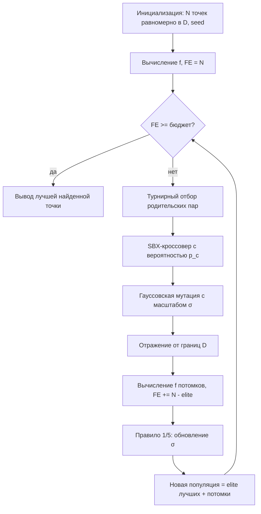
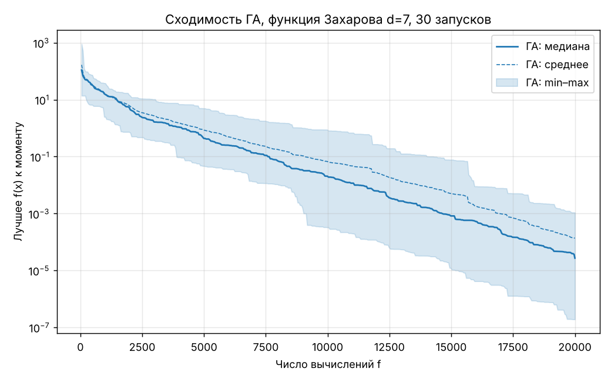
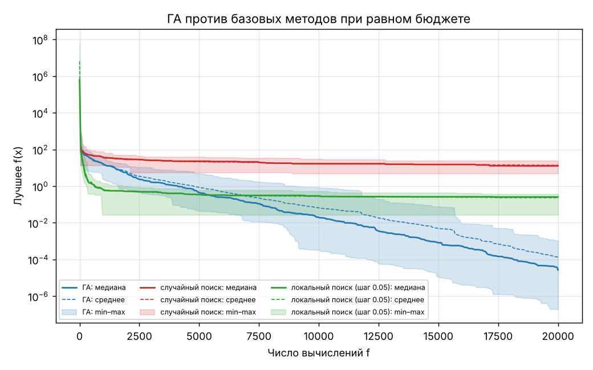
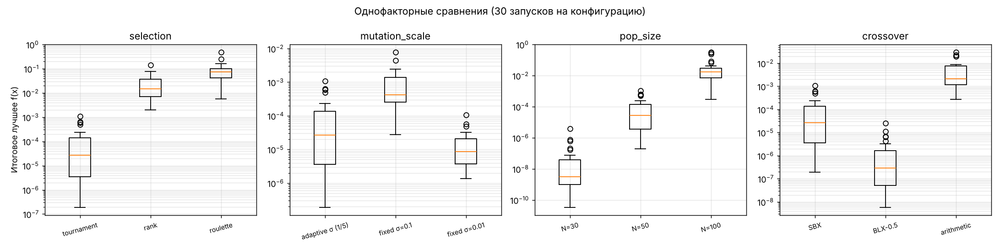
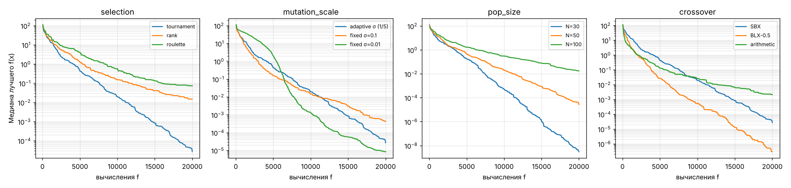
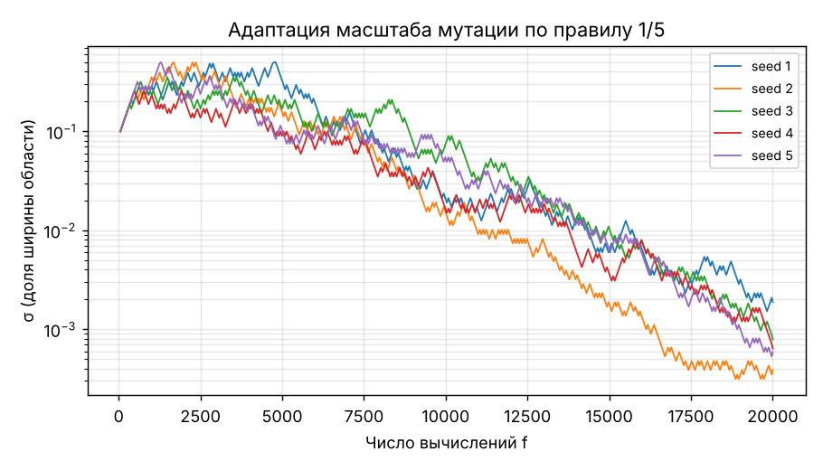

# Отчёт по лабораторной работе № 1

**Многомерная оптимизация сложной функции генетическим алгоритмом**
Дисциплина «Эволюционное программирование и генетические алгоритмы», НИЯУ МИФИ.
Студент: Яхиев Г. Индивидуальный вариант **V = 8**.

## 1. Постановка задачи и вариант

Для V = 8 размерность d = 5 + (V mod 6) = 5 + 2 = **7**. Функция варианта — **функция Захарова**:

$$f(\mathbf x)=\sum_{i=1}^{d}x_i^2+\Big(\sum_{i=1}^{d}0.5\,i\,x_i\Big)^2+\Big(\sum_{i=1}^{d}0.5\,i\,x_i\Big)^4,$$

Требуется найти $\min_{\mathbf x\in D} f(\mathbf x)$, где $D=[-5,10]^7$.

Теоретический глобальный минимум: $f(\mathbf 0)=0$. Это следует из того, что все три слагаемых неотрицательны и одновременно обращаются в ноль только при $\mathbf x=\mathbf 0$. Точка $\mathbf 0$ лежит внутри $D$.

## 2. Пространство решений, целевая функция, ограничения

* Пространство решений: $D=\prod_{i=1}^{7}[l_i,u_i]$ с $l_i=-5$, $u_i=10$. Ограничения только интервальные (box constraints).
* Целевая функция $f$ гладкая, выпуклая и **унимодальная**. Её сложность не в локальных минимумах, а в геометрии:
  * Обозначим $c_i = 0.5\,i$. Тогда $f(\mathbf x)=\|\mathbf x\|^2+s^2+s^4$, где $s=\mathbf c^\top\mathbf x$.
  * Гессиан в оптимуме: $H=2I+2\mathbf c\mathbf c^\top$. Собственные числа: 2 (кратность 6) и $2+2\|\mathbf c\|^2=72$. Число обусловленности **36**.
  * Вдали от оптимума доминирует член $s^4$. Значения $f$ на области меняются от 0 до $2.8\cdot10^{8}$, медиана на равномерной выборке около $1.5\cdot10^6$.
  * Функция почти плоская в 6 направлениях, ортогональных $\mathbf c$, и очень крутая вдоль $\mathbf c$. Получается узкая вытянутая «долина».

## 3. Представление особи

Вещественное кодирование: генотип совпадает с фенотипом, особь $=(x_1,\dots,x_7)$, $x_i\in[-5,10]$. Декодирование не требуется.

## 4. Алгоритм, операторы и параметры

| Параметр | Значение (базовая конфигурация, `config.json`) |
|---|---|
| Размер популяции N | 50 |
| Критерий остановки | бюджет **20 000** вычислений f (416 поколений) |
| Инициализация | равномерно в $D$ |
| Селекция родителей | турнир, k = 3 |
| Кроссовер | SBX, $\eta_c = 15$, $p_c = 0.9$ (пара без кроссовера копируется) |
| Мутация | гауссовская, ген мутирует с $p_m = 1/d \approx 0.143$, $x_i \leftarrow x_i + \sigma (u_i-l_i)\,\mathcal N(0,1)$ |
| Масштаб мутации | адаптивный, правило 1/5. Если в поколении доля потомков лучше «своего» родителя больше 0.2, то $\sigma\leftarrow\sigma/0.9$, иначе $\sigma\leftarrow 0.9\sigma$. $\sigma_0=0.1$, $\sigma\in[10^{-12},0.5]$ |
| Обработка границ | зеркальное отражение от границы с последующим `clip` |
| Замещение | поколенческое с элитизмом: 2 лучшие особи переходят без изменений, 48 мест занимают потомки |
| Seed | `numpy.random.default_rng(seed)`, серия seed = 1…30 (`--seed0`, `--runs`) |

Реализованы также альтернативы для сравнения:

* ранговая селекция (линейное ранжирование, давление s = 1.7);
* рулетка с масштабированием «окном» $g=f_{\max}-f$;
* BLX-0.5;
* арифметический кроссовер.

**Дополнительное задание** закрыто несколькими пунктами: адаптивный масштаб гауссовской мутации, ранговая селекция, SBX и BLX-α.

### Блок-схема

## 5. Обоснование выбора операторов

* **Турнир** инвариантен к монотонным преобразованиям f. Для функции Захарова это важно: из-за члена $s^4$ значения различаются на 8 порядков, и пропорциональная селекция без масштабирования вырождается. Давление регулируется размером турнира.
* **SBX** порождает потомков вблизи родителей, причём разброс пропорционален расстоянию между родителями. Когда популяция сжимается к оптимуму, шаги автоматически уменьшаются. Для вытянутой долины это лучше, чем фиксированный шаг.
* **Гауссовская мутация с адаптацией σ** нужна, чтобы шаг мутации уменьшался по мере уточнения решения. Фиксированный большой шаг не даёт точности, фиксированный маленький замедляет начало. Задача требует точности порядка $10^{-3}$ по координатам.
* **Отражение** от границ не создаёт скоплений точек на границе, в отличие от простого `clip`. Оптимум в $\mathbf 0$ находится внутри области, но близко к левой границе по сравнению с центром области (2.5).

## 6. Результаты (30 независимых запусков, бюджет 20 000 FE)

Полная таблица: [`results/summary.md`](results/summary.md). Все запуски: [`results/runs.csv`](results/runs.csv).
«Успех» означает $f<10^{-4}$. p-value получено критерием Манна–Уитни против базовой конфигурации на тех же seed.

| Конфигурация | Лучшее | Среднее | Медиана | Ст. откл. | Худшее | Успех | p |
|---|---|---|---|---|---|---|---|
| **ГА, базовая** | 1.90e-07 | 1.36e-04 | 2.71e-05 | 2.50e-04 | 1.09e-03 | 73% | — |
| Случайный поиск | 4.91e+00 | 1.41e+01 | 1.28e+01 | 4.93e+00 | 2.46e+01 | 0% | 3e-11 |
| Локальный поиск, шаг 0.05 | 2.74e-02 | 2.34e-01 | 2.57e-01 | 8.83e-02 | 3.74e-01 | 0% | 3e-11 |

Лучший запуск базовой конфигурации — seed 19, $f=1.9\cdot10^{-7}$. Найдена точка $\mathbf x\approx(1.3,\,-0.8,\,1.3,\,3.1,\,-0.4,\,-2.3,\,0.1)\cdot10^{-4}$. Воспроизведение: `python ga.py --seed 19`. Среднее время запуска 0.06 с.

### Однофакторные сравнения (меняется ровно один параметр)

| Фактор | Варианты: медиана итогового f (доля успехов) | p vs base |
|---|---|---|
| Селекция | **турнир 2.7e-05 (73%)** · ранговая 1.5e-02 (0%) · рулетка 7.3e-02 (0%) | 3e-11 / 3e-11 |
| Масштаб мутации | **адаптивный 2.7e-05 (73%)** · фикс. σ=0.1: 4.2e-04 (7%) · фикс. σ=0.01: 8.6e-06 (97%) | 5e-07 / 0.07 |
| Размер популяции | **N=30: 3.1e-09 (100%)** · N=50: 2.7e-05 (73%) · N=100: 1.8e-02 (0%) | 2e-10 / 5e-11 |
| Кроссовер | SBX 2.7e-05 (73%) · **BLX-0.5 3.0e-07 (100%)** · арифметический 2.1e-03 (0%) | 5e-07 / 1e-10 |
| Комбинация N=30 + BLX-0.5 | медиана **1.3e-15**, худшее 1.7e-12 (100%) | 3e-11 |

## 7. Анализ и выводы о влиянии параметров

1. **Селективное давление решает больше всего.** Функция унимодальна, поэтому сильное давление (турнир k=3) почти не грозит преждевременной сходимостью к «чужому» минимуму, а только ускоряет спуск.
   * Ранговая селекция при s=1.7 даёт лучшей особи всего в 1.7 раза больше шансов, чем средней. Медиана хуже турнира на 3 порядка.
   * Рулетка с масштабированием окном хуже рангов: несколько особей с $f$ близким к $f_{\max}$ сжимают различия между остальными.
2. **При фиксированном бюджете популяцию лучше брать меньше.** N=30 даёт 714 поколений против 416 у N=50 и 204 у N=100. Для унимодальной функции глубина поиска важнее разнообразия. Разница между N=30 и N=100 — 7 порядков по медиане.
3. **Кроссовер должен уметь расширять облако.**
   * Арифметический кроссовер только сжимает популяцию к выпуклой оболочке родителей. Разнообразие быстро теряется, и спуск поддерживает одна мутация.
   * BLX-0.5 выходит за пределы отрезка между родителями, поэтому лучше двигается вдоль долины.
4. **Адаптация σ по правилу 1/5 надёжнее «угаданного» фиксированного шага, но не оптимальна.**
   * σ=0.1 даёт плохую точность: медиана 4e-4.
   * σ=0.01 статистически неотличим от адаптивного (p=0.07) и даже чуть лучше по медиане. Но это значение пришлось угадать, а адаптивный вариант нашёл подходящий масштаб сам.
   * На графике видно, что адаптация сначала увеличивает σ до верхней границы 0.5, а затем почти линейно (в лог-шкале) уменьшает его до $10^{-3}$. Начальная фаза роста стоит части бюджета: это объясняет проигрыш хорошо подобранному фиксированному шагу.
5. Из однофакторных выводов собрана конфигурация N=30 + BLX-0.5. Она даёт медиану $1.3\cdot10^{-15}$ и 100% успехов: на 10 порядков лучше базовой.

## 8. Почему функция трудна для случайного и простого локального поиска

* **Случайный поиск.** Множество уровня $\{f<10^{-4}\}$ около оптимума — эллипсоид с полуосями $\sqrt{2\varepsilon/\lambda_i}$: 0.01 по шести осям и 0.0017 вдоль $\mathbf c$. Его объём ≈ $7.9\cdot10^{-15}$, объём области $15^7\approx1.7\cdot10^8$. Вероятность попасть в него одной случайной точкой ≈ $4.6\cdot10^{-23}$. За 20 000 точек случайный поиск в среднем находит лишь $f\approx14$. Это проклятие размерности в чистом виде.
* **Локальный поиск с фиксированным шагом.**
  * Из-за обусловленности 36 и квартичного члена шаг, подходящий для «плоских» направлений, слишком велик вдоль $\mathbf c$: почти любой сдвиг с компонентой вдоль $\mathbf c$ ухудшает $f$.
  * Когда точка в долине, доля улучшающих шагов падает до нуля, и поиск застревает на уровне $f\sim\sigma^2$: медиана 0.26.
  * Нужны шаги, согласованные с геометрией и убывающие со временем. Это и дают SBX/BLX (шаг пропорционален разбросу популяции) и адаптация σ.

## 9. Почему результат следует считать хорошим

* Цель — приблизить глобальный минимум $f^*=0$. Базовый ГА в 73% запусков достигает $f<10^{-4}$, что соответствует точности $\|\mathbf x\|\lesssim 10^{-2}$ на области шириной 15.
* Настроенная конфигурация в 100% запусков достигает $f<2\cdot10^{-12}$. Это близко к пределу, полезному для вещественной арифметики при таком масштабе задачи.
* Разница с равнобюджетными базовыми методами — 5–7 порядков, статистически значима ($p\approx3\cdot10^{-11}$).

Ограничения честно указаны:

* Функция унимодальна и гладкая. Квази-ньютоновский метод с градиентом решил бы её быстрее, так что эволюционный подход здесь оправдан как учебный: он не требует градиента.
* Выводы о размере популяции и силе селекции специфичны для унимодальных функций. На многоэкстремальных функциях (Растригин, Швефель) малые N и сильное давление, скорее всего, привели бы к преждевременной сходимости.
* Значения $p$ не скорректированы на множественные сравнения. Однако почти все они меньше $10^{-6}$, так что выводы не меняются и после поправки Бонферрони.
