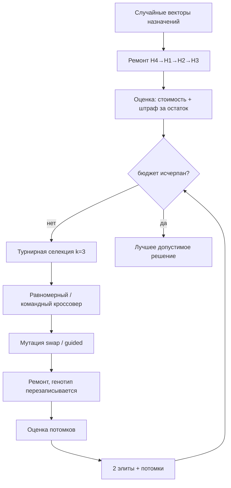
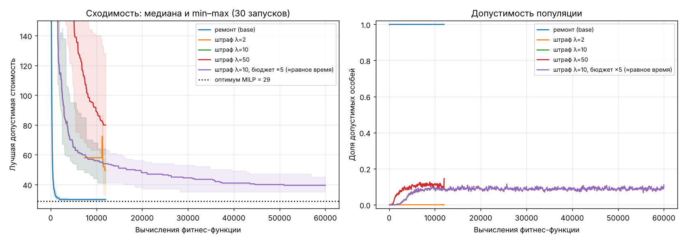
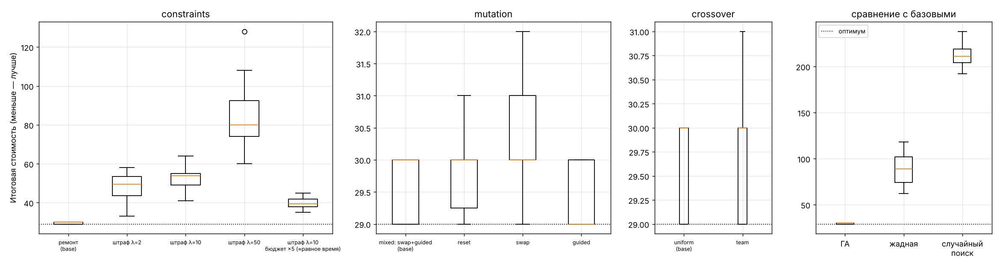
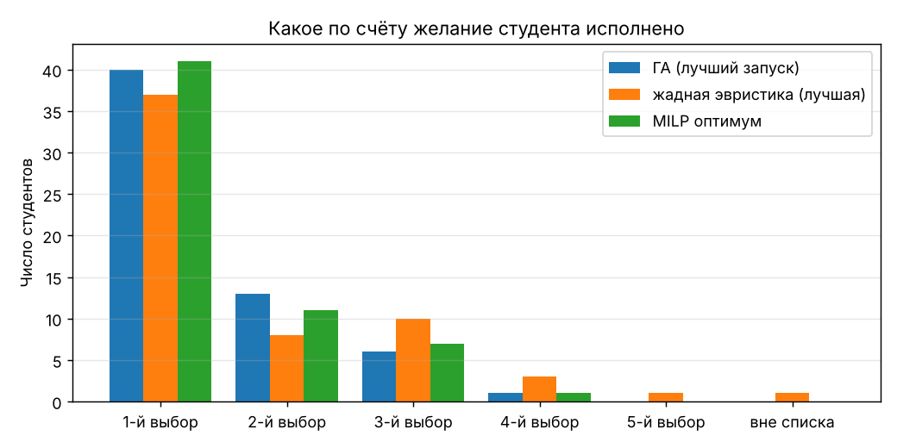

# Отчёт по лабораторной работе № 2

**Генетический алгоритм для дискретной задачи с ограничениями**
Студент: Яхиев Г. Вариант **V = 8**: «Назначение студентов на проекты с предпочтениями и ограничением вместимости команд», основное представление — вектор назначений.

## 1. Постановка задачи

Есть $n=60$ студентов и $P=10$ проектов. Каждый студент ранжирует 5 проектов. Каждому проекту нужна команда.

**Данные.** Экземпляр синтетический: `data/instance.json`, генератор `generate_data.py`, seed 2026. Процедура генерации:

1. «Популярность» проекта $w_j\sim\mathrm{LogNormal}(0,0.6)$.
2. Списки предпочтений — выборка 5 проектов без возвращения с вероятностями $\propto w_j$ (модель Плакетта–Льюса).
3. У каждого студента 1–2 навыка из {ML, backend, frontend, data}. Проекту требуется 1–2 навыка.
4. Вместимость $c_j\in\{5,6,7,8\}$, суммарно 64 места на 60 студентов. Минимальный размер команды $m_j=3$.
5. 12 конфликтующих пар студентов.

Масштаб превышает минимум из задания (≥ 20 объектов, ≥ 5 ресурсов). Конкуренция за места реальная:
* 15 студентов ставят первым проект 3, в котором 6 мест;
* проект 2 не ставит первым никто, а проект 8 — лишь один человек, но команды нужны и им.

**Пространство решений:** $\mathbf a\in\{0,\dots,9\}^{60}$, где $a_i$ — проект студента $i$. Всего $10^{60}$ векторов.

**Целевая функция** (минимизация суммарной неудовлетворённости):
$$f(\mathbf a)=\sum_{i=1}^{n}\mathrm{cost}(i,a_i),\qquad \mathrm{cost}=0,1,2,4,7 \text{ за 1…5-й выбор},\ 15 \text{ вне списка}.$$
Шкала выпуклая: два студента на втором месте лучше, чем один на первом и один на четвёртом. Так в цель заложена справедливость.

**Жёсткие ограничения:**

| | Ограничение |
|---|---|
| H1 | $\lvert\{i: a_i=j\}\rvert\le c_j$ — вместимость команды |
| H2 | $\lvert\{i: a_i=j\}\rvert\ge m_j$ — минимальный размер команды |
| H3 | для каждого требуемого навыка проекта $j$ в команде есть его носитель |
| H4 | конфликтующие студенты не попадают в одну команду |

## 2. Представление и почему оно отражает структуру решения

Генотип совпадает с фенотипом: вектор назначений длины 60 с алфавитом из 10 проектов.

* **Полнота.** Каждый студент назначен ровно в один проект. Ограничение «один студент — один проект» выполняется по построению, его не нужно штрафовать, в отличие от бинарной матрицы $x_{ij}$ (600 бит).
* **Локальность.** Изменение одного гена — перевод одного студента. Это минимальное осмысленное изменение решения, и соседние генотипы соответствуют близким решениям.
* **Что остаётся контролировать.** H1–H4 зависят от совокупности генов. Ими занимаются процедура ремонта или штраф.

Примеры решений целиком: [`results/examples.md`](results/examples.md).

| Решение | Стоимость | Нарушения |
|---|---|---|
| Допустимое 1: лучшее решение ГА (seed 1) | 29 | 0 |
| Допустимое 2: жадная эвристика + ремонт | 62 | 0 |
| Недопустимое 1: «каждому — его первый выбор» | 0 | 28: переполнение 18, недобор 6, навыки 2, конфликты 2 |
| Недопустимое 2: потомок равномерного кроссовера двух допустимых решений | 41 | 4: переполнение команд |
| Недопустимое 3: случайный вектор | 537 | 9 |
| То же после ремонта | 437 | 0 |

Строка «недопустимое 1» показывает, почему ограничения нельзя игнорировать: идеальная по цели точка грубо недопустима. Строка «недопустимое 2» показывает, что кроссовер двух допустимых родителей порождает недопустимого потомка.

## 3. Алгоритм и операторы

| Параметр | Значение (`config.json`) |
|---|---|
| Популяция | 60 |
| Бюджет (критерий остановки) | 12 000 вычислений фитнес-функции (~200 поколений) |
| Инициализация | равномерно случайные векторы, затем ремонт |
| Селекция | турнир, k = 3 |
| Кроссовер | равномерный, $p_c=0.9$. Альтернатива: «командный» |
| Мутация | число ходов $1+\mathrm{Poisson}(0.5)$. Ход — swap или guided с вероятностью 1/2 (`mixed`). Альтернативы: reset, swap, guided |
| Ограничения | ламарковский ремонт. Если что-то не исправилось, штраф 1000 за нарушение. Альтернатива: штраф λ·(число нарушений) |
| Замещение | поколенческое, 2 элитные особи |
| Seed | `--seed`, серия 1…30 |

**Операторы, специализированные под представление:**

* **swap** — обмен проектами двух студентов. Размеры всех команд не меняются, поэтому H1 и H2 сохраняются.
* **guided** — перевод студента в один из трёх его самых желанных проектов. Мутация направлена по структуре целевой функции.
* **reset** — случайный новый проект. Универсальная мутация, нужна для сравнения.
* **Командный кроссовер.**
  1. Для случайного подмножества проектов $S$ ребёнок наследует целые команды первого родителя.
  2. Остальные студенты сохраняют проект второго родителя, если тот не входит в $S$.
  3. Иначе студент получает самый желанный проект вне $S$.

  Так наследуются «строительные блоки» — сложившиеся команды, а не отдельные гены.

**Процедура ремонта** (`problem.Instance.repair`). Она жадная и детерминированная. Порядок: H4 → H1 → H2 → H3, повтор до стабилизации.

* Каждый шаг выбирает перемещение студента с наименьшим приростом стоимости среди ходов, которые не создают новых нарушений:
  * не перегружают команду;
  * не забирают единственного носителя навыка;
  * не сводят конфликтующих.
* Для H3 рассматривается и обмен двух студентов: носитель навыка ↔ участник команды. Обмен сохраняет размеры обеих команд.

На 1000 случайных векторов ремонт даёт допустимое решение в 99.9% случаев. Остаток наказывается штрафом 1000.

### Блок-схема

## 4. Результаты (30 независимых запусков, seed 1…30)

Таблица: [`results/summary.md`](results/summary.md). Каждый запуск с итоговым вектором назначений: [`results/runs.csv`](results/runs.csv).

**Эталон качества.** Для экземпляра такого размера задача решается точно как задача целочисленного линейного программирования. Решатель HiGHS через `scipy.optimize.milp` находит оптимум **29** за 0.01 с. MILP используется только для оценки качества ГА, не внутри алгоритма. Статистика считается по стоимости лучшего допустимого решения.

### 4.1 Работа с ограничениями: ремонт против штрафов

| Конфигурация | Допустимо | Лучшее | Среднее | Медиана | Ст. откл. | Худшее | Оптимум найден | Время, с |
|---|---|---|---|---|---|---|---|---|
| **Ремонт (base)** | 100% | 29 | 29.6 | 30 | 0.5 | 30 | 37% | 1.6 |
| Штраф λ=2 | 13% | 33 | 47.5 | 49.5 | 10.7 | 58 | 0% | 0.3 |
| Штраф λ=10 | 100% | 41 | 53.0 | 54 | 5.4 | 64 | 0% | 0.3 |
| Штраф λ=50 | 100% | 60 | 82.9 | 80 | 14.9 | 128 | 0% | 0.3 |
| Штраф λ=10, бюджет ×5 (≈ равное время) | 100% | 35 | 39.8 | 39.5 | 2.9 | 45 | 0% | 1.5 |

Кривая λ=10 на графике скрыта под кривой «λ=10, бюджет ×5». При тех же seed эти прогоны совпадают на первых 12 000 вычислениях.

### 4.2 Операторы мутации и кроссовера (при ремонте)

| Оператор | Среднее | Медиана | Худшее | Оптимум найден | p (Манн–Уитни vs base) |
|---|---|---|---|---|---|
| mixed: swap + guided (base) | 29.6 | 30 | 30 | 37% | — |
| reset | 29.9 | 30 | 31 | 27% | 0.15 |
| swap | 30.3 | 30 | 32 | 13% | 0.0009 |
| **guided** | **29.3** | **29** | 30 | **70%** | 0.011 |
| Командный кроссовер (вместо равномерного) | 29.9 | 30 | 31 | 30% | 0.19 |

### 4.3 Сравнение с простыми методами

| Метод | Бюджет | Среднее | Медиана | Лучшее | Худшее |
|---|---|---|---|---|---|
| **ГА (base)** | 12 000 | **29.6** | **30** | 29 | 30 |
| Жадная эвристика + ремонт (30 случайных порядков) | 1 | 88.6 | 89 | 62 | 118 |
| Случайный допустимый поиск (случайный вектор + ремонт) | 12 000 | 211.6 | 211 | 192 | 238 |
| MILP (точный оптимум) | — | 29 | 29 | 29 | 29 |

### 4.4 Лучшее решение в предметной форме

Полные составы команд с местом проекта в списке каждого студента и навыками: [`results/best_solution.md`](results/best_solution.md).

| Желание студента | ГА (seed 1) | Оптимум MILP | Жадная (лучшая из 30) |
|---|---|---|---|
| 1-й выбор | 40 | 41 | 37 |
| 2-й выбор | 13 | 11 | 8 |
| 3-й выбор | 6 | 7 | 10 |
| 4-й / 5-й выбор | 1 / 0 | 1 / 0 | 3 / 1 |
| Вне списка | 0 | 0 | 1 |

Найденное ГА решение имеет ту же стоимость 29, что и MILP, но другое распределение: это альтернативный оптимум.

## 5. Анализ

1. **Ремонт решительно лучше штрафов** при равном числе вычислений: медиана 30 против 54 при лучшем λ.
   * Ремонт дороже по времени в ~5 раз. Но и при равном времени (штраф с бюджетом ×5) штрафной ГА достигает лишь медианы 39.5.
   * Причина видна на правом графике: при штрафах в популяции допустимы лишь ~10% особей. Поиск идёт в основном по недопустимой области, а «хорошие» допустимые решения отделены от неё узкими проходами.
2. **Коэффициент штрафа работает как классическая «вилка».**
   * Слабый штраф (λ=2): нарушение одного ограничения выгоднее, чем перевести студента на 4-й выбор. Популяция стабилизируется в недопустимой области, и допустимое решение найдено лишь в 4 из 30 запусков.
   * Сильный штраф (λ=50): всё сводится к поиску любой допустимой точки, цель почти не оптимизируется (медиана 80).
   * Промежуточный λ=10 лучше обоих.
3. **Выбор мутации.**
   * Направленная мутация guided статистически лучше (p=0.011): находит оптимум в 70% запусков против 37%. Она использует структуру цели: ход «в любимый проект» почти всегда полезен, а нарушение вместимости ремонт исправляет перемещением кого-то другого.
   * Чистый swap хуже всех (p<0.001). Он не меняет размеры команд, поэтому не может перераспределить места между проектами, а именно это и нужно, когда популяция застряла на неверных размерах.
4. **Командный кроссовер** не дал значимого выигрыша (p=0.19). После ремонта команды и так стабильны, а равномерный кроссовер с ремонтом фактически комбинирует их не хуже.
5. **Как диагностировалась преждевременная сходимость.** Все 19 неоптимальных запусков базовой конфигурации остановились на стоимости 30, в одном шаге от оптимума. Это локальный оптимум относительно ходов «переместить одного студента»: чтобы получить 29, нужна цепочка из 2–3 согласованных перемещений. Отсюда рекомендация: при большем бюджете добавить мутацию «цепочка перемещений» (ejection chain) или локальный поиск по обменам.

## 6. Почему результат хороший

* Все 30 запусков ГА дают допустимое решение не хуже 30 при доказанном оптимуме 29, то есть отклонение ≤ 3.4%.
* 37% запусков (70% с мутацией guided) находят точный оптимум.
* С пользовательской точки зрения 40 из 60 студентов получают первый выбор, 59 — один из трёх первых, никто не остаётся вне своего списка.
* Жадная эвристика в среднем втрое хуже (88.6) и оставляет студентов вне списка.

**Честное ограничение.** Для данного экземпляра и линейной цели задача решается точно методом ветвей и границ за сотые доли секунды. Эволюционный подход здесь оправдан учебно и в ситуациях, когда:

* цель становится нелинейной: баланс команд по навыкам или средним оценкам, «дружеские пары» с квадратичным бонусом;
* ограничения задаются неявно, например проверкой стороннего сервиса;
* нужно быстро получить много разных хороших решений, а не одно.

ГА с ремонтом переносится на такие постановки без изменений, MILP — нет.
