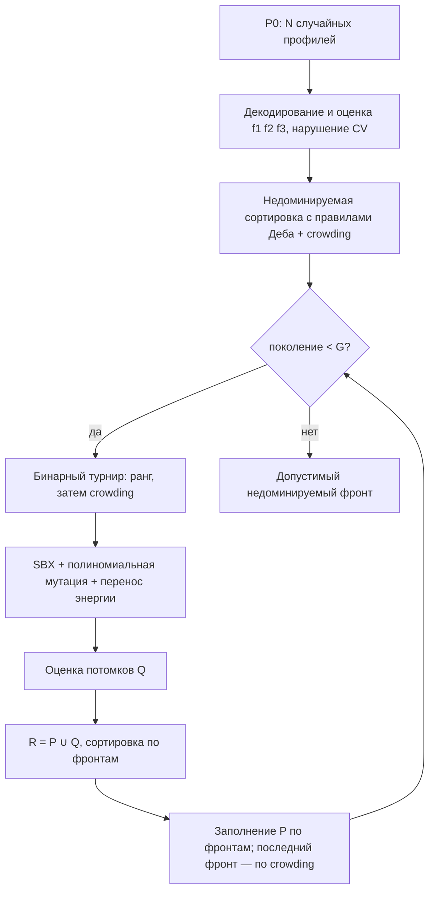
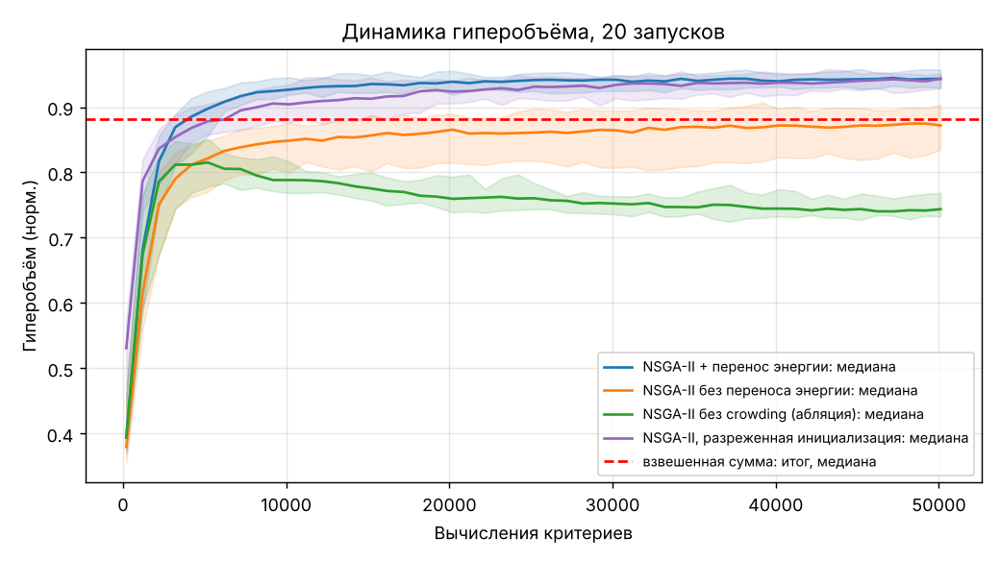
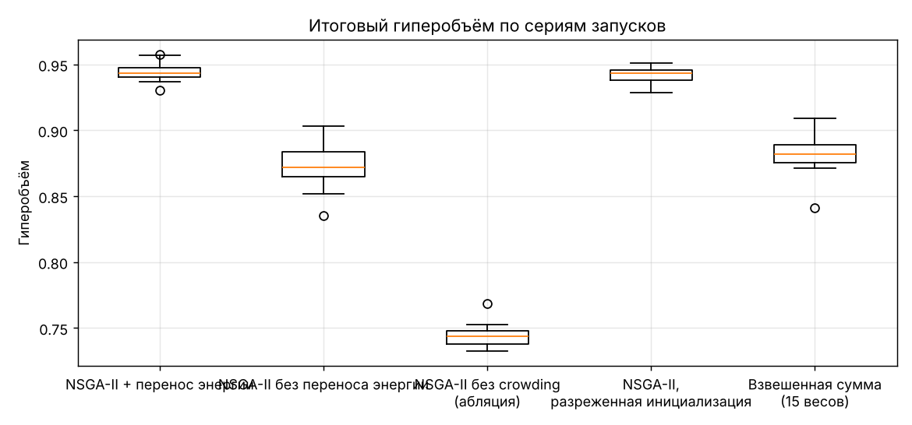
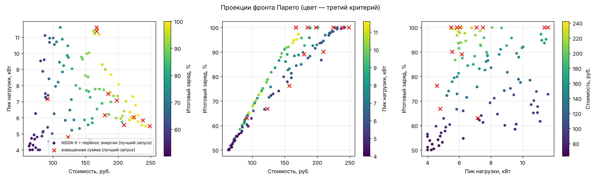
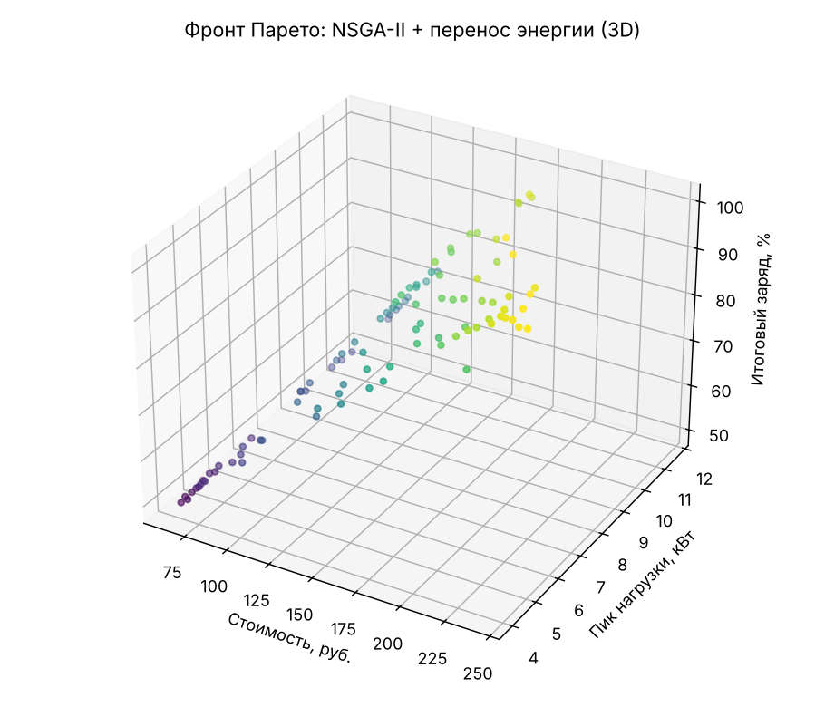
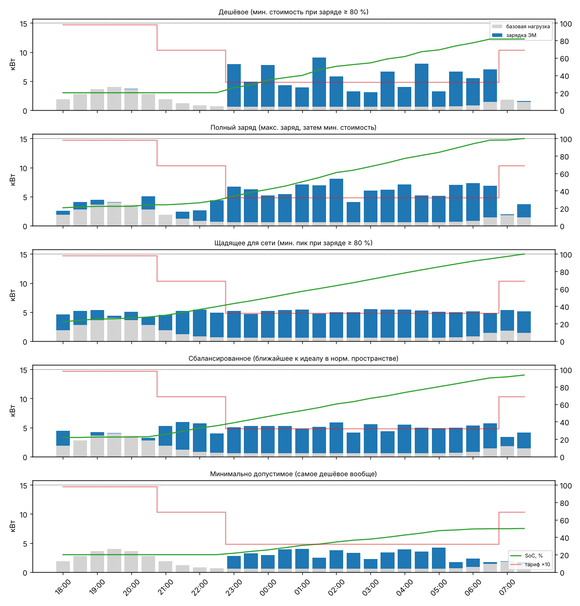

# Отчёт по лабораторной работе № 3, трек A

**Многокритериальная эволюционная оптимизация: планирование зарядки электромобиля**
Студент: Яхиев Г. Вариант **V = 8**, трек A: «Планирование зарядки электромобиля / накопителя энергии». Критерии: минимум стоимости, минимум пикового потребления, максимум уровня заряда.

## 1. Постановка

Электромобиль подключается дома в 18:00 и уезжает в 08:00: 14 ч, $T=28$ слотов по 30 мин.

**Параметры модели** (синтетические, заданы в `model.py`):

| Параметр | Значение |
|---|---|
| Аккумулятор | 60 кВт·ч |
| Начальный заряд | 20% |
| КПД зарядки | 0.92 |
| Мощность зарядного устройства | до 11 кВт |
| Лимит подключения дома | 15 кВт |
| Тариф (условный трёхзонный), руб/кВт·ч | 9.80 (18–21 ч), 6.90 (21–23 и 07–08 ч), 3.20 (ночь 23–07 ч) |
| Базовая нагрузка дома | вечерний пик 4 кВт около 19:30, ночью 0.6 кВт, утренний подъём |

**Переменные:** $\mathbf p\in[0,11]^{28}$ — заданная мощность зарядки по слотам.

**Декодирование генотипа в фенотип:**

1. Ремонт по лимиту сети: $p_t\leftarrow\min(p_t, 15-b_t)$. Ограничение H1 так выполняется всегда.
2. Пошаговый расчёт заряда SoC. Когда батарея заполнена, лишняя мощность не потребляется и не оплачивается.

**Критерии (все минимизируются):**
$$f_1=\sum_t c_t p_t\,\Delta t\ \text{(руб.)},\qquad f_2=\max_t(b_t+p_t)\ \text{(кВт)},\qquad f_3=-\mathrm{SoC}_{\text{final}}\ (\%).$$

**Жёсткое ограничение H2:** $\mathrm{SoC}_{\text{final}}\ge 50\%$, иначе машина бесполезна утром. Оно учитывается через доминирование с ограничениями (правила Деба):

* допустимое решение лучше недопустимого;
* из двух недопустимых лучше то, у которого меньше нарушение;
* среди допустимых действует доминирование по Парето.

**Почему критерии противоречат друг другу:**

* Больше заряда — больше купленной энергии, то есть $f_1$ растёт вместе с $-f_3$.
* Самая дешёвая полная зарядка — только ночью: 52 кВт·ч за 8 ч дают ~6.5 кВт в среднем и пик ≈ 7 кВт.
* Минимальный пик требует растянуть зарядку на все 14 ч, включая дорогой вечер. Тогда пик ≈ 5 кВт, но стоимость выше.

**Точные ориентиры.** При фиксированном уровне заряда минимум $f_1$ и минимум $f_2$ по отдельности — задачи линейного программирования. Они решены через `scipy.optimize.linprog` и используются только для проверки качества фронта.

| Заряд | 50% | 80% | 100% |
|---|---|---|---|
| Мин. стоимость, руб. | 62.6 | 125.2 | 167.0 |
| Мин. пик, кВт | 4.00 | 4.12 | 5.05 |

## 2. Представление и способ сравнения решений

Особь — вещественный вектор длины 28. Он естественен для задачи: каждый ген — мощность в своём слоте, соседние слоты — соседние гены.

Решения сравниваются по **доминированию Парето с ограничениями**. Взвешенная свёртка не подходит как основной метод:

* веса стоимости, пика и заряда несоизмеримы (рубли, киловатты, проценты);
* выбор между ними — решение пользователя, а не алгоритма;
* свёртка не находит невыпуклых участков фронта.

Свёртка реализована для сравнения (п. 5).

## 3. Алгоритм

**NSGA-II** (`nsga2.py`) реализован без готовых библиотек:

* быстрая недоминируемая сортировка, $O(MN^2)$, с правилами Деба;
* расстояние скопления (crowding distance);
* бинарный турнир по паре (ранг, −crowding);
* $(\mu+\lambda)$-отбор: объединение родителей и потомков, заполнение по фронтам, последний фронт обрезается по crowding.

**Механизмы, которых не было в ЛР № 1–2:**

* недоминируемая сортировка;
* расстояние скопления;
* доминирование с ограничениями;
* проблемно-ориентированная мутация «перенос энергии» (`model.shift_mutation`). С вероятностью 0.6 потомок получает один ход: срез пика — часть мощности переносится из слота с максимальной суммарной нагрузкой в слот с минимальной, либо перенос в дешёвые часы — из самого дорогого заряжающего слота в наименее загруженный ночной. Купленная энергия при этом сохраняется.

| Параметр | Значение (`config.json`) |
|---|---|
| Популяция | 100 |
| Поколений | 500 → бюджет **50 100** вычислений критериев |
| Кроссовер | покоординатный SBX, $\eta_c=15$, $p_c=0.9$ |
| Мутация | полиномиальная, $\eta_m=20$, $p_m=2/28$, затем перенос энергии с вероятностью 0.6 |
| Инициализация | равномерная в $[0,11]^{28}$ |
| Запуски | 20 независимых, seed 1…20 |

**Метрика качества** — точный гиперобъём (HV) допустимых недоминируемых точек.

* Пространство критериев нормировано на физические границы: стоимость от 0 до 511 руб. (полная зарядка по пиковому тарифу), пик от 4 до 15 кВт, заряд от 100 до 50%.
* Точка отсчёта (1.1, 1.1, 1.1).
* HV в 3D считается методом срезов, реализация проверена тестом против Монте-Карло.

## 4. Результаты (20 запусков, бюджет 50 100)

Полная таблица: [`results/summary.md`](results/summary.md). По запускам: [`results/runs.csv`](results/runs.csv).

| Алгоритм | Лучший HV | Средний | Медиана | Ст. откл. | Худший | Точек во фронте | p vs основной |
|---|---|---|---|---|---|---|---|
| **NSGA-II + перенос энергии** | **0.957** | **0.944** | **0.943** | 0.007 | **0.930** | 99.7 | — |
| NSGA-II без переноса энергии | 0.903 | 0.873 | 0.872 | 0.015 | 0.836 | 99.3 | 7e-08 |
| NSGA-II без crowding (абляция) | 0.769 | 0.744 | 0.744 | 0.008 | 0.732 | 99.2 | 7e-08 |
| NSGA-II, разреженная инициализация | 0.951 | 0.942 | 0.943 | 0.007 | 0.929 | 99.7 | 0.47 |
| Взвешенная сумма, 15 весов, тот же бюджет | 0.909 | 0.882 | 0.882 | 0.013 | 0.841 | 10.6 | 7e-08 |

Крайние точки (медиана по 20 запускам) против LP-ориентиров:

| Алгоритм | Мин. стоимость @80% (LP 125.2) | @100% (LP 167.0) | Мин. пик @80% (LP 4.12) | @100% (LP 5.05) |
|---|---|---|---|---|
| NSGA-II + перенос энергии | 128.3 | 200.0 | 5.47 | 5.55 |
| NSGA-II без переноса | 125.6 | 172.5 | 6.84 | 6.85 |
| Взвешенная сумма | 167.0 (нет точки ~80%) | 167.0 | 5.38 | 5.71 |

### Фронт Парето

При трёх критериях фронт показан тремя проекциями (цвет — третий критерий) и в 3D. Сам фронт с профилями: [`results/best_front.csv`](results/best_front.csv).

### Характерные решения (лучший по HV запуск, seed 1)

| Решение | Стоимость, руб. | Пик, кВт | Заряд, % | Смысл |
|---|---|---|---|---|
| **Дешёвое** | 129.3 | 9.03 | 81.7 | Заряжать только ночью и мощно. 100% энергии по ночному тарифу. Для бюджета, когда сеть не ограничивает и полный заряд не нужен |
| **Полный заряд** | 200.9 | 8.07 | 100.0 | Перед дальней поездкой. 86% энергии ночью, остальное в дорогие часы, чтобы гарантированно добрать 100% |
| **Щадящее для сети** | 242.2 | 5.48 | 100.0 | Почти ровная «заливка» по всем 14 ч, нагрузка дома не выше 5.5 кВт. Подходит для слабого ввода или если у сетевой компании тариф за мощность |
| **Сбалансированное** | 204.2 | 5.94 | 93.6 | Ближайшее к идеалу в нормированном пространстве. Почти полный заряд при низком пике; переплата ~37 руб. к LP-минимуму стоимости полной зарядки (167 руб.) |
| **Минимально допустимое** | 63.4 | 4.24 | 50.0 | Ровно 50% к утру по ночному тарифу, пик почти не выше базовой нагрузки. Для коротких городских поездок |

## 5. Сравнение с взвешенной суммой

ГА с той же вариацией (SBX, полиномиальная мутация, перенос энергии) решал 15 однокритериальных задач. Веса — равномерная симплекс-решётка с шагом 1/4, бюджет поровну, ~3 320 вычислений на вектор весов (популяция 40).

* Свёртка даёт в среднем лишь **10.6 различных** недоминируемых решений и значимо меньший HV (0.882 против 0.944, $p=7\cdot10^{-8}$).
* Главный провал — середина фронта. Например, нет ни одного решения с зарядом ~80%: ближайшее имеет 100% и стоит 167 руб. Значит, пользователь, которому хватит 80% за 125 руб., такого варианта не увидит.
* Причина двойная:
  * несколько векторов весов сходятся в одну и ту же крайнюю точку;
  * пространство критериев здесь склеено из «углов». Пик — функция максимума, а заряд упирается в 100%. Участки фронта между углами не являются точками касания линейной свёрткой, то есть фронт локально невыпуклый.
* Зато свёртка лучше NSGA-II в одной крайней точке: полный заряд за минимальную стоимость, 167.0 руб., ровно LP-оптимум. Она тратит на эту точку целый подбюджет.

## 6. Анализ и выводы

1. **Расстояние скопления — ключевой механизм разнообразия.** Без него HV падает с 0.944 до 0.744, и даже уменьшается со временем (зелёная кривая). Когда первый фронт больше популяции, случайное усечение выбрасывает крайние точки, и фронт стягивается к середине. Абляция наглядно показывает, зачем в NSGA-II crowding.
2. **Оператор, учитывающий структуру задачи, важнее настройки параметров.** Перенос энергии повышает HV с 0.872 до 0.943 и снижает минимальный пик при полном заряде с 6.85 до 5.55 кВт (LP-предел 5.05).
   * Целевая функция $f_2$ — максимум по слотам. Покоординатная мутация уменьшает пик только при одновременном снижении всех «высоких» слотов, а перенос энергии делает это одним ходом.
   * Цена: точка «полный заряд за минимум денег» хуже (200 против 172.5 руб.). Она лежит не на крае фронта по одному критерию, а на ребре между двумя, и при 100 точках на трёхмерный фронт её покрытие редкое.
3. **Гипотеза о разреженной инициализации не подтвердилась.** Без переноса энергии она даже ухудшала HV, а с ним различие незначимо ($p=0.47$). В итоговой конфигурации оставлена равномерная инициализация.

## 7. Почему результат хороший

* Основной алгоритм в каждом из 20 запусков строит фронт из ~100 допустимых решений с HV 0.93–0.96, стандартное отклонение 0.007. Метод устойчив, а не «повезло в одном запуске».
* Крайние точки близки к доказуемым LP-границам:
  * минимальная стоимость при 50% — 63.3 против 62.6;
  * при 80% — 128.3 против 125.2;
  * минимальный пик при 50% — 4.00, ровно LP.
* Наибольший разрыв — пик при 100%: 5.55 против 5.05 кВт, то есть 10%. Это честное ограничение работы.
* **Что улучшить:** архив недоминируемых решений (всё найденное, а не только последняя популяция), опорные точки NSGA-III для равномерного покрытия 3D-фронта, локальный поиск по переносу энергии для точек на рёбрах фронта.
* Пользователь получает весь спектр компромиссов «руб. ↔ кВт ↔ %». Выбор по нему осмыслен: например, переход от «дешёвого» 80% к «сбалансированному» 94% стоит +75 руб. и снижает пик на 3 кВт.
