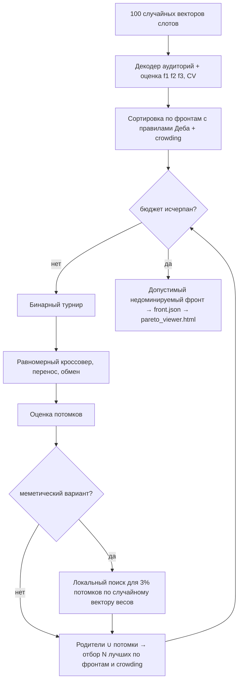
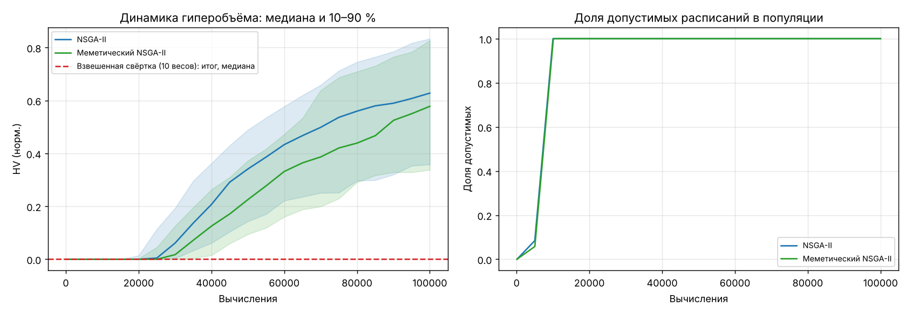
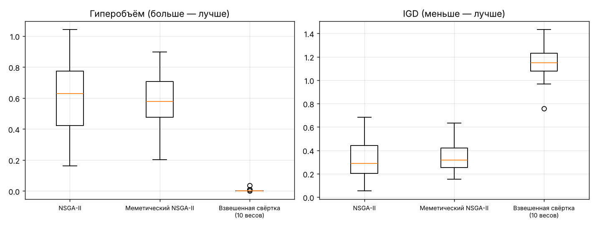
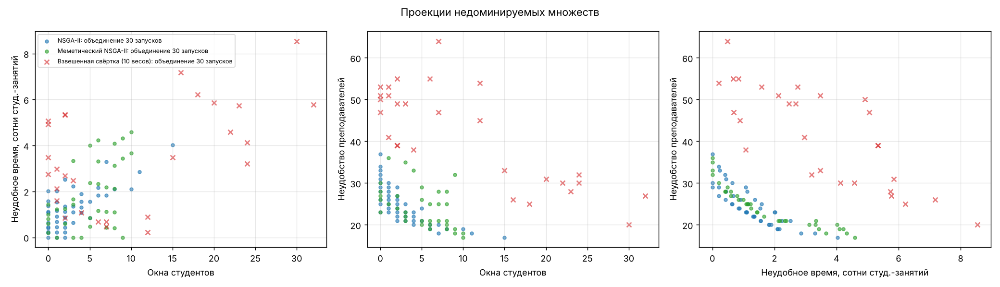

# Отчёт по лабораторной работе № 4

**Многокритериальное проектирование расписания с интерактивным выбором решения из фронта Парето**
Студент: Яхиев Г. Вариант **V = 8** (тема 8 из перечня ЛР № 4). Заявка: [PROPOSAL.md](PROPOSAL.md). Демонстрация: [DEMO.md](DEMO.md).

## 1. Постановка

**Данные** — синтетический экземпляр `data/instance.json` (генератор `generate_data.py`, seed 2026):

* 5 дней × 6 пар = 30 слотов;
* 8 групп по 20–28 студентов в двух потоках по 4 группы;
* 80 занятий: 16 потоковых лекций по 90–93 человека, 48 семинаров, 16 лабораторных. У каждой группы 16 занятий в неделю;
* 12 преподавателей: 4 лектора, 6 семинаристов, 2 преподавателя лабораторных. У каждого 3–6 недоступных слотов и 2 предпочитаемых дня из 5;
* 9 аудиторий: 2 поточные (120 и 110 мест), 1 на 60, 4 семинарские (30–35), 2 лаборатории.

**Генотип:** $\mathbf x\in\{0,\dots,29\}^{80}$ — слот каждого занятия.

**Фенотип:** полное расписание «занятие → (день, пара, аудитория)». Аудитории назначает детерминированный декодер, отдельно для обычных аудиторий и лабораторий:

* в каждом слоте занятия по убыванию размера;
* для проверки ограничений: k-е по размеру занятие — в k-ю по вместимости аудиторию;
* для показа пользователю: наименьшая подходящая свободная аудитория (best-fit).

Для вложенных вместимостей оба способа размещают всех в одних и тех же случаях: назначение существует тогда и только тогда, когда k-е по размеру занятие помещается в k-ю по вместимости аудиторию для всех k. Поэтому аудитории не нужно включать в генотип, и пространство поиска сокращается с $(30\cdot9)^{80}$ до $30^{80}$.

**Жёсткие ограничения** (CV — число нарушений):

| | Ограничение |
|---|---|
| H1 | у группы не более одного занятия в слоте |
| H2 | у преподавателя не более одного занятия в слоте |
| H3 | преподаватель не ставится в недоступный слот |
| H4 | каждому занятию нашлась аудитория нужного типа и вместимости |

**Критерии** (все минимизируются):

| | Критерий | Смысл |
|---|---|---|
| $f_1$ | окна студентов | Σ по группам и дням числа пустых пар между первым и последним занятием |
| $f_2$ | неудобное время | число студенто-занятий на 1-й (09:00) и 6-й (17:20) парах, в сотнях |
| $f_3$ | неудобство преподавателей | занятия в непредпочитаемые дни + окна преподавателей |

**Почему критерии конфликтуют:**

* У группы 16 занятий, а «хороших» средних пар 4 × 5 = 20. Уйти с крайних пар ($f_2$) можно, только плотно упаковывая середину дня, а это при пересечениях потоков порождает окна ($f_1$).
* Преподаватели хотят работать в 2 выбранных дня ($f_3$). Это стягивает занятия групп в те же дни и снова создаёт окна и крайние пары.

**Корректность оценки.** Векторизованная оценка всей популяции сверена с наивным подсчётом по определениям на 25 случайных расписаниях (`tests/test_lab4.py`). Декодер аудиторий согласован с H4 на 300 случайных расписаниях.

## 2. Архитектура эволюционного поиска

* **Сравнение решений:** доминирование с ограничениями (правила Деба). Жёсткие ограничения не превращаются в штрафы с подбираемыми коэффициентами.
* **Вариация** (общая для всех алгоритмов):
  * равномерный кроссовер слотов, $p_c=0.9$;
  * мутация «перенос занятия в случайный слот» для каждого гена с вероятностью $1/80$;
  * обмен слотами двух занятий с вероятностью 0.3 на особь.

| Вариант | Описание |
|---|---|
| **A. NSGA-II** | Популяция 100, быстрая недоминируемая сортировка, crowding distance, бинарный турнир, $(\mu+\lambda)$-отбор |
| **B. Меметический NSGA-II** | То же. Дополнительно 3% потомков проходят 5 шагов локального поиска (в духе MOGLS): случайный вектор весов $w\sim\mathrm{Dir}(1,1,1)$; ход — перенос конфликтного занятия (у недопустимых), случайный перенос или обмен; ход принимается, если CV не растёт и взвешенная сумма не ухудшается. Шаги расходуют общий бюджет |
| **C. Взвешенная свёртка** | 10 векторов весов (симплекс-решётка с шагом 1/3). Для каждого — ГА с популяцией 40 и $(\mu+\lambda)$-отбором по ключу (CV, $\sum w_k f_k/s_k$), $s=(10,2,40)$. Бюджет делится поровну |

**Бюджет:** 100 000 вычислений на запуск у всех вариантов. **30 независимых запусков**, seed 1…30.

**Метрики качества.**

* **Эталонный фронт** — недоминируемые точки объединения всех запусков всех алгоритмов: 39 точек. Идеал (0, 0, 17), надир (15, 4.59, 37).
* **HV** — точный 3D-гиперобъём в нормированном по эталону пространстве, точка отсчёта (1.1, 1.1, 1.1). Максимум ≈ 1.33.
* **IGD** — среднее расстояние от точек эталона до ближайшей найденной точки.
* **Сравнение:** критерий Манна–Уитни и мера эффекта Варга–Делани $A_{12}$ (0.5 — нет различия, < 0.5 — хуже NSGA-II).

## 3. Результаты (30 запусков)

Полная таблица: [`results/summary.md`](results/summary.md). Каждый запуск с его фронтом: [`results/runs.csv`](results/runs.csv).

| Алгоритм | HV лучший | HV средний | HV медиана | HV ст. откл. | HV худший | IGD медиана | Точек во фронте | Время, с | p (HV) | $A_{12}$ |
|---|---|---|---|---|---|---|---|---|---|---|
| **NSGA-II** | **1.043** | **0.610** | **0.628** | 0.215 | 0.163 | **0.290** | 57.9 | 6.2 | — | — |
| Меметический NSGA-II | 0.899 | 0.586 | 0.578 | 0.178 | 0.203 | 0.317 | 51.4 | 8.4 | 0.67 | 0.47 |
| Взвешенная свёртка (10 весов) | 0.036 | 0.002 | 0.000 | 0.007 | 0.000 | 1.149 | 7.3 | 3.3 | 5e-12 | 0.00 |

Все запуски всех алгоритмов нашли допустимые расписания.

## 4. Итоговый фронт и интерактивный выбор

Пользователю предъявляется не фронт одного запуска, а **недоминируемая часть объединения 30 запусков NSGA-II: 45 расписаний**. Это законно: каждое из них допустимо и проверено повторной оценкой (тест `test_front_export_is_feasible_if_present`).

| Решение | Окна студентов | Неудобное время, сотни | Неудобство преподавателей | Смысл |
|---|---|---|---|---|
| Без окон для студентов | 0 | 2.02 | 23 | Студенты приходят к первой паре и уходят без пауз, но ~200 студенто-занятий на крайних парах |
| Удобное время | 1 | 0.00 | 30 | Ни одного занятия в 09:00 и 17:20. Платят преподаватели: больше занятий в непредпочитаемые дни |
| Удобное преподавателям | 15 | 4.03 | 17 | Преподаватели работают в «свои» дни, а студенты получают 15 окон и много крайних пар |
| **Сбалансированное** | 2 | 1.11 | 23 | Ближайшее к идеалу в нормированном пространстве. 2 окна на 8 групп за неделю |

Сетки расписания группы Б26-50 для этих решений: [`results/representative.md`](results/representative.md).

**Инструмент выбора** — [`results/pareto_viewer.html`](results/pareto_viewer.html), автономная страница без сети и библиотек:

* точечная диаграмма фронта с выбором осей, цвет — третий критерий;
* фильтры «не хуже чем» по каждому критерию;
* ползунки важности и кнопка «рекомендованное»: минимум взвешенной суммы нормированных критериев среди прошедших фильтры;
* клик по точке показывает сетку расписания выбранной группы, преподавателя или аудитории. Окна заштрихованы, крайние пары подсвечены;
* выгрузка выбранного расписания в JSON.

Страница проверена в Chrome (headless): сценарий из DEMO.md выполняется без ошибок JavaScript. Пример: фильтр «окна = 0» оставляет 11 из 45 решений, а при важности «неудобного времени» = 5 рекомендуется расписание (0; 0.00; 37). Нет ни окон, ни крайних пар, и видно, что за это платят преподаватели.

Консольная альтернатива — `choose.py`.

## 5. Анализ

1. **Свёртка проигрывает на порядки** (HV 0.002 против 0.61, $A_{12}=0$). Причин две:
   * у свёртки нет механизма разнообразия: 10 весов дают в среднем 7.3 различных точки, а участки фронта между весами не покрываются;
   * каждый вектор весов начинает поиск заново. Допустимая область достигается лишь за ~10 000 вычислений (правый график сходимости), а у свёртки это весь подбюджет одного веса. Её решения едва допустимы и далеки от фронта даже в направлении собственных весов.

   NSGA-II тратит поиск допустимой области один раз на всю популяцию.
2. **Меметический поиск не окупился** — честный отрицательный результат.
   * В итоговой настройке разница с NSGA-II статистически не значима ($p=0.67$, $A_{12}=0.47$). Время на ~35% больше: одиночные вызовы оценки дороже пакетных.
   * В предварительных пробах (seed 1–5) более агрессивная меметика была хуже NSGA-II. Пробовались: 10% потомков × 10 шагов с приёмкой по доминированию, затем ремонт только недопустимых. Итоговая настройка (3% × 5 шагов) — лучшая из проб.
   * **Причина:** оценка расписания дешёвая (~0.03 мс на расписание в пакетном режиме), и популяционный поиск NSGA-II с мутацией «перенос / обмен» уже выполняет те же локальные ходы, но параллельно и с отбором по Парето. Локальный поиск со случайными весами стягивает отдельные решения к точкам свёртки и обедняет фронт.
3. **Устойчивость.** Разброс HV между запусками NSGA-II велик (0.16–1.04, ст. откл. 0.22).
   * HV продолжает расти к концу бюджета (левый график): при 100 000 вычислений поиск не сошёлся.
   * В пробных запусках на seed 1–5 HV одного запуска при бюджете 100 000 был в 2.5–5 раз выше, чем при 30 000 (первая версия эксперимента).
   * Поэтому один запуск не даёт надёжного фронта. Пользователю передаётся объединение запусков, а для выводов используются статистики по 30 запускам.

## 6. Почему эволюционный подход оправдан и почему результат хороший

* Задача — многокритериальное расписание с жёсткими ограничениями. Даже однокритериальная версия NP-трудна (раскраска графа конфликтов с дополнительными условиями). Точное перечисление фронта для 80 занятий и 30 слотов недоступно.
* NSGA-II строит **набор** компромиссов за 6 с.
* Итоговый фронт содержит решения:
  * с **нулём окон** у всех 8 групп;
  * с **нулём занятий на крайних парах**;
  * с минимумом **17** «неудобств» преподавателей.

  Каждое из них обращает в ноль или минимизирует свой критерий при допустимых значениях остальных. Это и есть цель многокритериальной постановки: дать лицу, принимающему решения, обоснованный выбор, а не одно «оптимальное» расписание.

## 7. Ограничения и направления улучшения

* **Данные синтетические.** Нет мягких предпочтений по аудиториям, переходов между корпусами, чётных и нечётных недель.
* **Бюджет.** HV не вышел на плато. Полезны:
  * внешний архив всех найденных недоминируемых решений;
  * больший бюджет или островная модель;
  * NSGA-III с опорными направлениями для равномерного покрытия трёхмерного фронта.
* **Улучшенная вариация.** Цепочки Кемпе — обмены занятий между двумя слотами без новых конфликтов — сохраняют допустимость. Вероятно, они будут эффективнее случайных переносов.
* **Интерактивность.** Сейчас выбор идёт после поиска (a posteriori). Следующий шаг — интерактивное сужение поиска по ходу эволюции: точка предпочтений, R-NSGA-II.
